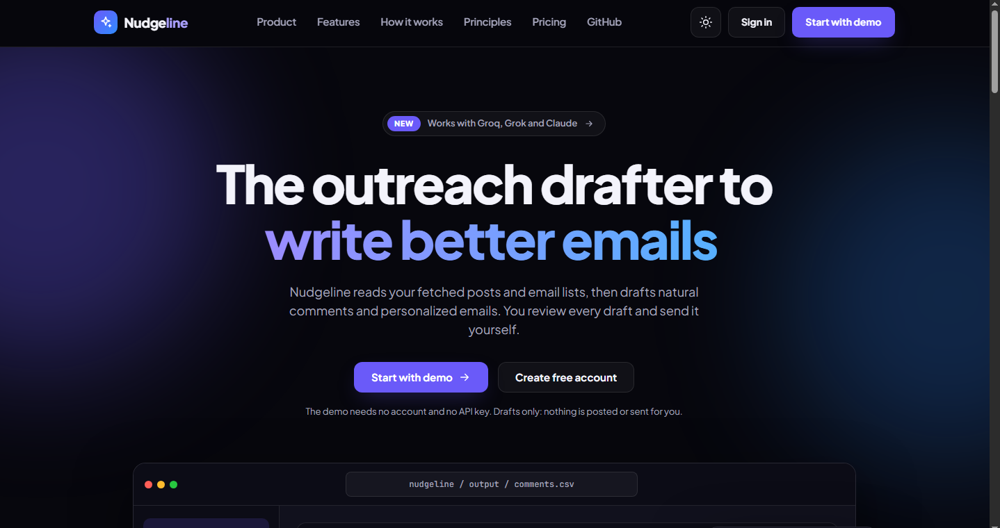
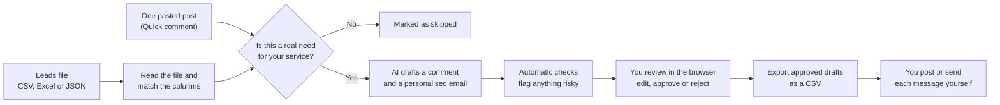
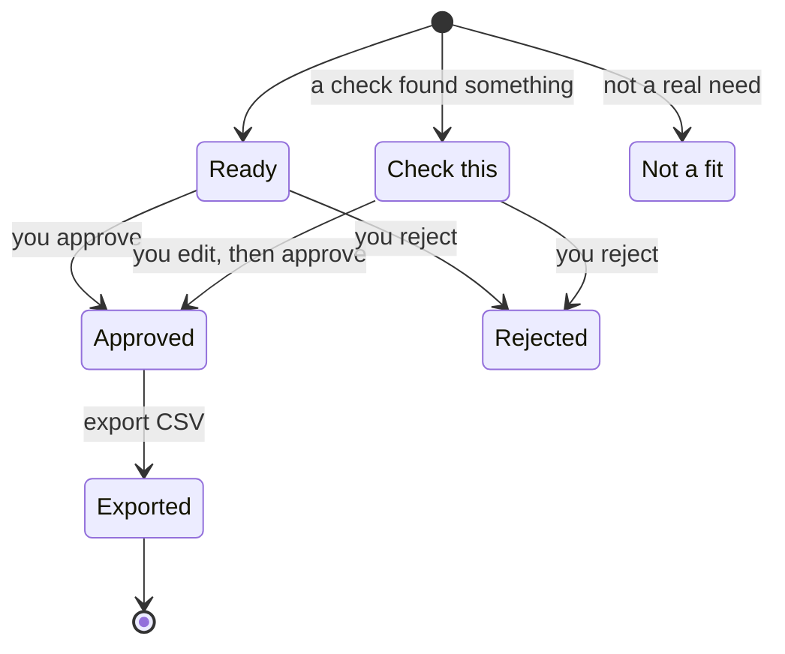
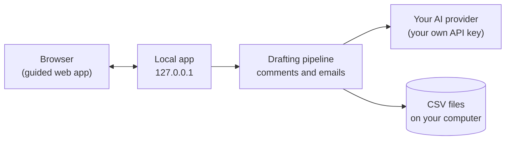
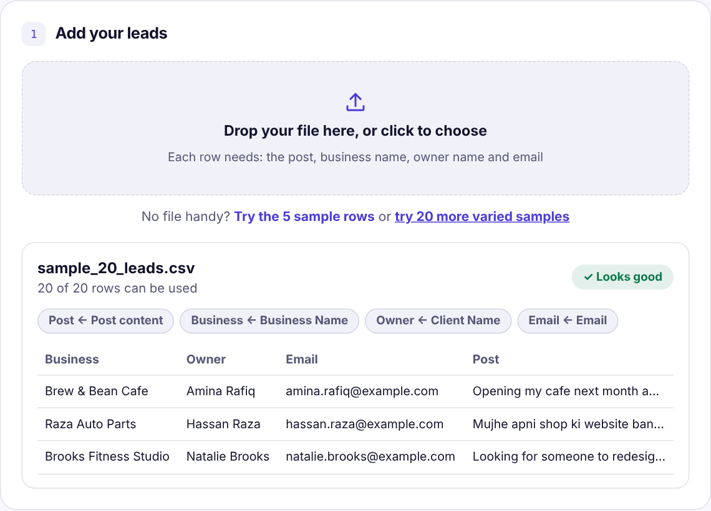
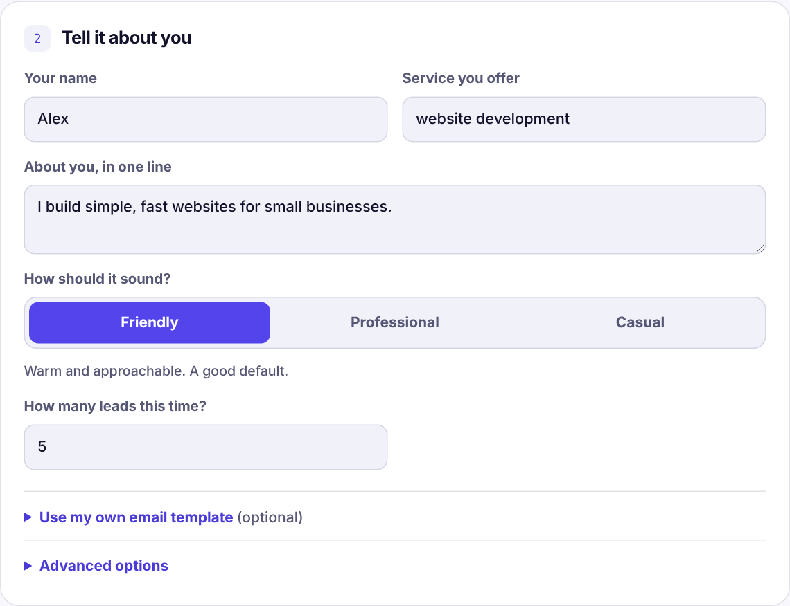
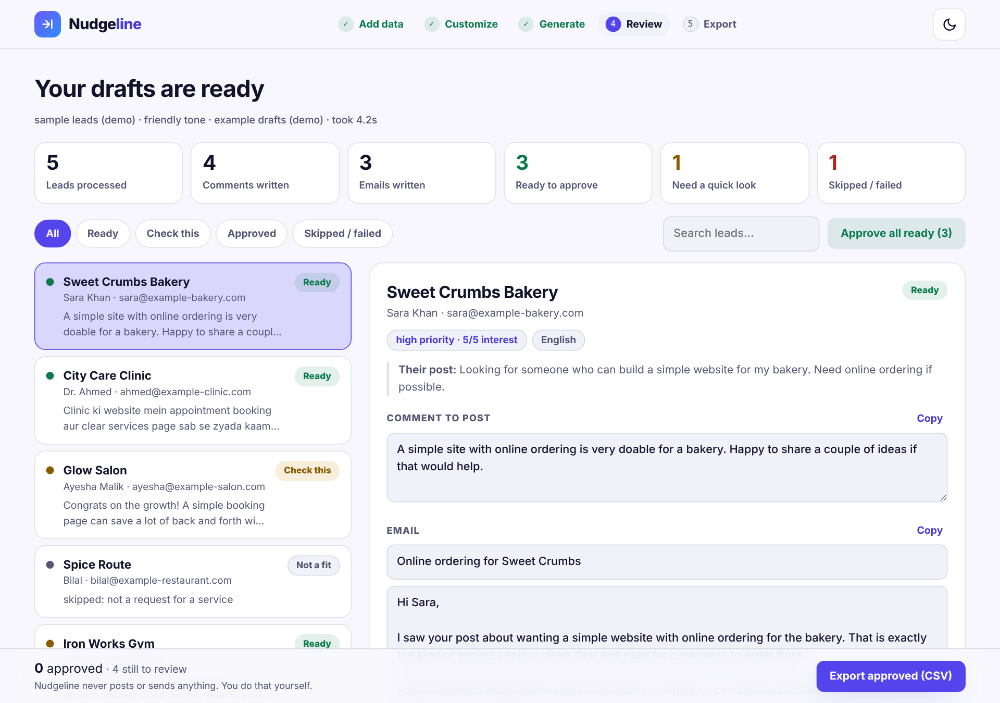
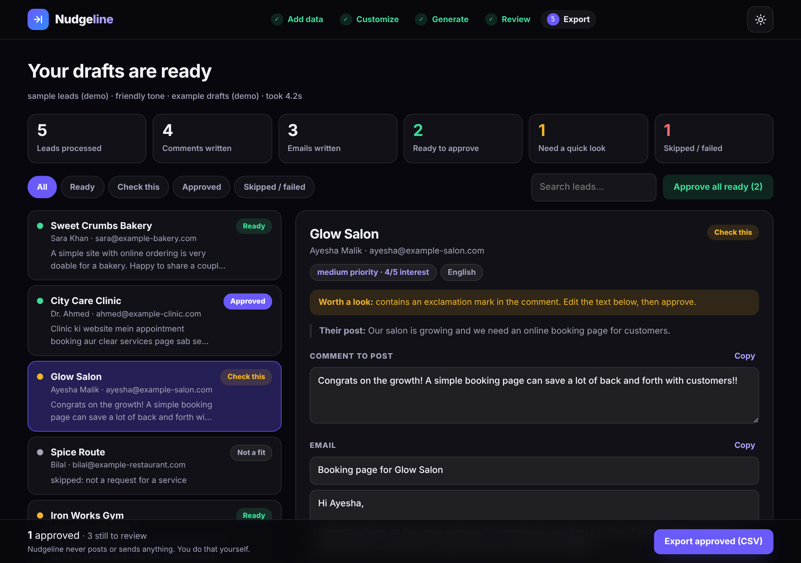
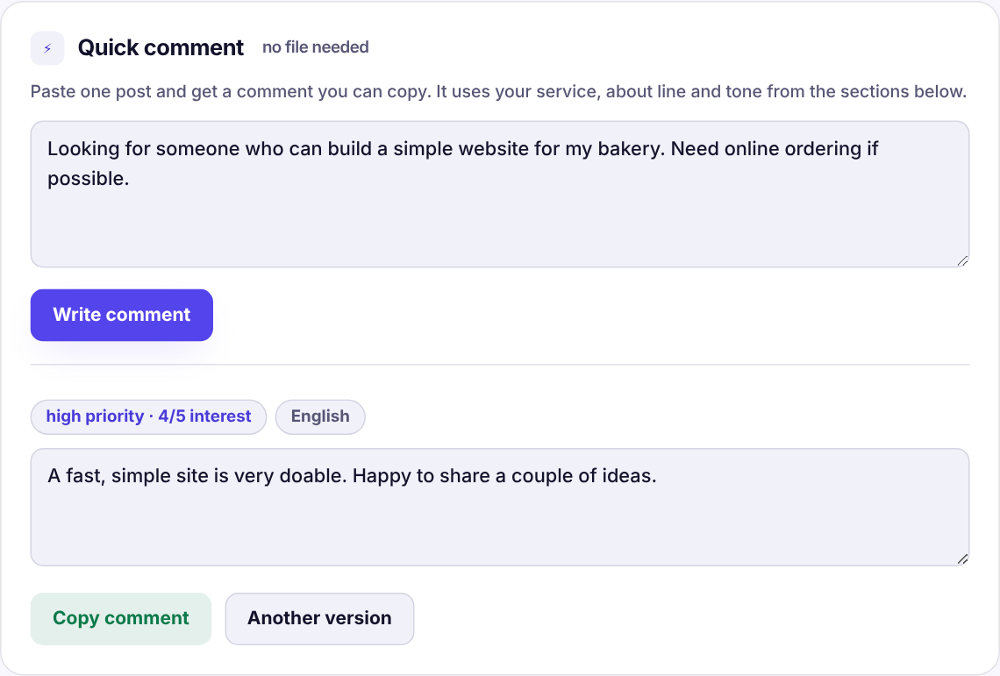
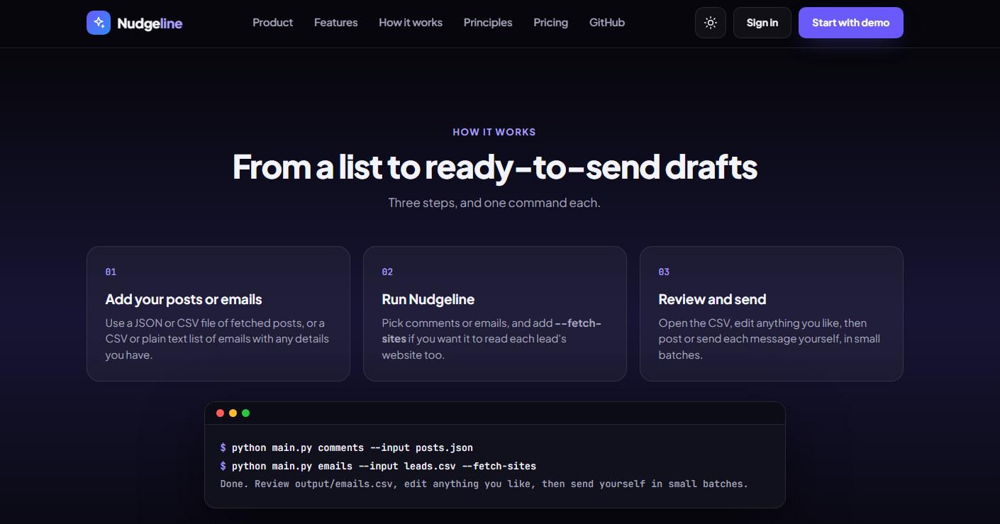

<div align="center">

# Nudgeline

**Turn a list of leads into comments and emails that are ready to review.**
Nudgeline drafts a natural comment for a lead's post and a personalised email for the lead. You read, edit and approve everything, then post or send it yourself.




</div>

---

## Contents

- [What it does](#what-it-does)
- [How it works](#how-it-works)
- [A look at the app](#a-look-at-the-app)
- [Requirements](#requirements)
- [Quick start](#quick-start)
- [Using the web app, step by step](#using-the-web-app-step-by-step)
- [Your input file](#your-input-file)
- [Email templates](#email-templates)
- [Command line](#command-line)
- [Output](#output)
- [Project layout](#project-layout)
- [Sending responsibly](#sending-responsibly)
- [Privacy](#privacy)
- [Troubleshooting](#troubleshooting)

---

## What it does

You bring a list of leads: each row has a post, a business name, an owner name and an email. For every row Nudgeline writes:

- **a comment** to reply to their post, short and specific to what they wrote, and
- **a personalised email** with a subject and body that refer to that same post.

Then it hands the drafts to **you**. Nothing is ever posted or sent by the tool. There is no auto-send, no scraping and no bot account.

| | |
|---|---|
| **Guided web app** | Upload, customise, generate, review, export. Opens in your browser. |
| **Quick comment** | Paste a single post and get one comment to copy. No file needed. |
| **Human review step** | Every draft is a suggestion until you press **Approve**. Only approved drafts can be exported. |
| **Your voice** | Pick a tone (friendly, professional, casual) or use your own email template. |
| **Skips what does not fit** | Posts that are not a real need for your service are marked as skipped instead of getting a forced reply. |
| **Automatic checks** | Drafts that look risky or off are flagged for a closer look before you approve. |
| **Language aware** | Replies in the language of the post, including Roman Urdu. |
| **Safe to stop and resume** | Command line runs save progress as they go. Run the same command again and it continues, retrying rows that failed. |
| **Bring your own AI key** | Works with Groq, Grok (xAI) or Claude. You use your own account. |
| **Runs on your computer** | Your lead data stays on your machine. |

---

## How it works



Every draft ends up in one of these states:



And at a high level the pieces fit together like this:



---

## A look at the app

### 1. Add your leads
Drop a CSV, Excel or JSON file. Nudgeline matches your column names automatically and shows what it understood before you run anything. No file handy? Try the built-in samples.



### 2. Tell it about you
Your name, the service you offer, one line about you, the tone, and how many leads to do this time. Optionally add your own email template.



### 3. Review and approve
A clean summary first, then a list of leads with a detail panel. Read each draft, edit it, and approve or reject. Drafts that need a closer look are marked **Check this**.



Dark mode is supported too:



### 4. Just need one comment?
Use **Quick comment**: paste a post, press **Write comment**, copy the result.



### How the process is explained on the home page



> Screenshots use made-up sample leads.

---

## Requirements

| What | Details |
|---|---|
| **Python** | 3.10 or newer (developed and tested on 3.12) |
| **Operating system** | Windows, macOS or Linux (developed on Windows) |
| **An AI API key** | One of: Groq (`gsk_...`), xAI Grok (`xai-...`), or Anthropic Claude (`sk-ant-...`) |
| **A web browser** | Any modern browser, for the local web app |
| **Python packages** | `openai`, `anthropic`, `httpx`, `openpyxl` (installed from `requirements.txt`) |
| **Internet** | Only for the calls to your AI provider |

No database, no Docker and no browser automation are needed.

---

## Quick start

**1. Get the code**

```bash
git clone https://github.com/Hafsa-Anwar65/NudgeLine.git
cd NudgeLine
```

**2. Create a virtual environment (recommended) and install**

Windows (PowerShell):
```powershell
python -m venv .venv
.venv\Scripts\Activate.ps1
pip install -r requirements.txt
```

macOS / Linux:
```bash
python3 -m venv .venv
source .venv/bin/activate
pip install -r requirements.txt
```

**3. Add your AI key**

```powershell
copy .env.example .env        # Windows
```
```bash
cp .env.example .env          # macOS / Linux
```

Open `.env` and paste **one** key (the line for your provider). Never commit this file: it is already in `.gitignore`.

**4. Start the app**

```bash
python app.py
```

It opens `http://127.0.0.1:8000`. Press `Ctrl+C` in the terminal to stop it.

---

## Using the web app, step by step

1. **Open the app.** Run `python app.py` and use the **Start with demo** button on the home page to see finished example drafts first, or go straight to the app.
2. **Add your leads.** Drop your file or click to choose it. Check the "Looks good" summary: it shows which of your columns were used for post, business, owner and email.
3. **Tell it about you.** Fill in your name, the service you offer and one line about you. Pick a tone.
4. **Choose how many leads.** Start small (3 to 5) to see the style, then do the full list.
5. *(Optional)* **Use your own email template.** Open the template section and use the placeholders described [below](#email-templates).
6. **Generate drafts.** Press the button and watch the progress bar. You can leave the page open while it works.
7. **Review.** Use the summary tiles and filter tabs (Ready, Check this, Approved, Skipped / failed). Click a lead, read the drafts and edit them directly in the boxes. Changes save automatically.
8. **Approve or reject.** Press **Approve** on each draft you are happy with, or **Approve all ready** for the ones with no warnings. Drafts marked **Check this** always need your own look first.
9. **Export.** Press **Export approved (CSV)**. Only approved drafts are included.
10. **Post or send yourself.** Copy each comment or email and use it from your own accounts, in small batches.

---

## Your input file

CSV, Excel (`.xlsx`) or JSON. Column names are matched loosely, so your existing headers usually just work.

| Field | Accepted column names (examples) |
|---|---|
| Post | `Post content`, `post_text`, `post`, `content`, `message`, `text` |
| Business | `Business Name`, `company`, `business`, `page_name` |
| Owner | `Owner Name`, `Client Name`, `name`, `owner`, `contact` |
| Email | `Email`, `email_address`, `owner_email` |
| Website *(optional)* | `website`, `site`, `url` |
| Post link *(optional)* | `post_url`, `link`, `permalink` |

Example:

| Client Name | Business Name | Post content | Email |
|---|---|---|---|
| Amina Rafiq | Brew & Bean Cafe | Opening my cafe next month and need a website with a menu and online reservations. | amina@example.com |

Samples to try are in the `sample/` folder (`old_data.csv` with 5 rows, `more_samples.csv` / `more_samples.xlsx` with 20 varied rows, including posts that are *not* leads and rows with a bad email).

---

## Email templates

Prefer your own wording? Paste a template and the AI only fills in the placeholders:

```
Subject: Quick idea for {company}

Hi {first_name},

{post_hook}

I build simple, fast websites for small businesses. Happy to share a few ideas if useful.

Best,
Your Name
```

| Placeholder | Filled with |
|---|---|
| `{first_name}` | The owner's first name |
| `{name}` | The owner's full name |
| `{company}` | The business name |
| `{post_hook}` | One sentence that refers to their post |

Leave the template empty to let the AI write each email from scratch.

---

## Command line

The same drafting engine is available without the browser:

```bash
python main.py comments --input sample/posts.json
python main.py emails   --input sample/leads.csv
python main.py both     --input sample/more_samples.csv --limit 5
python main.py approve  --input output/outreach.csv --interactive
```

| Command | What it does |
|---|---|
| `comments` | Drafts comments for already-fetched posts (JSON or CSV) |
| `emails` | Drafts personalised emails from a CSV or a plain list of emails |
| `both` | One run, two drafts per row: a comment and an email (CSV, Excel or JSON) |
| `approve` | The review step for the command line: export only what you approve |

Handy options: `--limit 5` (try a few first), `--dry-run` (test everything without calling the AI), `--tone friendly|professional|casual`, `--template path.txt`, `--output path.csv`. Running a command again resumes where it stopped.

Set your name, service and sign-off in `profile.json`.

---

## Output

The web app saves every run under `output/` (this folder is ignored by git). Exports contain only the drafts you approved.

| Column | Meaning |
|---|---|
| `name`, `company`, `email` | The lead |
| `post_text` | Their post |
| `comment` | The drafted comment |
| `subject`, `body` | The drafted email |
| `priority`, `language` | How strongly the post asks for your service, and its language |
| `qa_flags` | Why a draft was marked **Check this**, if it was |
| `status` | `draft`, `needs_edit`, `approved`, `rejected`, `skipped` or `error` |

---

## Project layout

```
NudgeLine/
├── app.py            # starts the local web app
├── main.py           # command line entry point
├── profile.json      # your name, service and sign-off
├── drafter/          # the drafting pipeline (comments, emails, review)
├── webui/            # the guided web app (HTML, CSS, JavaScript)
├── frontend/         # the home page
├── sample/           # example inputs to try
├── docs/screenshots/ # images used in this README
├── requirements.txt
└── .env.example      # copy to .env and add your key
```

---

## Sending responsibly

Nudgeline writes the first draft. You are responsible for what you send or post.

- Read every draft and make sure it is true and relevant to that person.
- Follow the rules of the platform where you comment, and the email rules that apply to you (for example CAN-SPAM, GDPR and local laws). Keep your opt-out line.
- Go slowly and in small batches. Do not mass-send.
- Only contact people who have publicly asked for what you offer.

---

## Privacy

- The app runs on **your computer** and listens on `127.0.0.1` only.
- Your files and drafts are stored in the local `output/` folder.
- The only data that leaves your machine is the text sent to **your own AI provider** to write the drafts, under your own API key.
- `.env` (your key) and `output/` are excluded from git. Check `git status` before you push.

---

## Troubleshooting

| Problem | What to try |
|---|---|
| `No API key found` | Open `.env` and paste your key on the matching line, then restart `python app.py`. |
| `Model not found` / `404` | Your account may not have the default model. Set `LLM_MODEL` in `.env` to a model name from your provider's console. |
| `Port 8000 is busy` | Run `python app.py --port 8001`. |
| Drafts show "AI service is busy" | You reached your provider's rate limit. Wait a minute and run again, or try fewer leads. On the command line, running the same command again retries failed rows. |
| The page looks old after an update | Restart `python app.py`, then press `Ctrl+F5` in the browser. |
| Excel file not read | Make sure the first row has headers and the file is `.xlsx`. |

---

<div align="center">

Nudgeline is under active development.
Made by [Hafsa Anwar](https://github.com/Hafsa-Anwar65).

</div>
